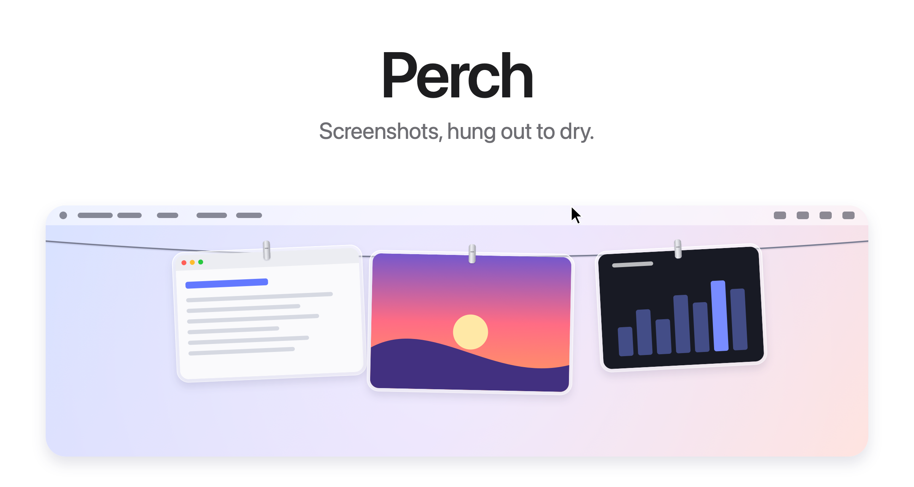
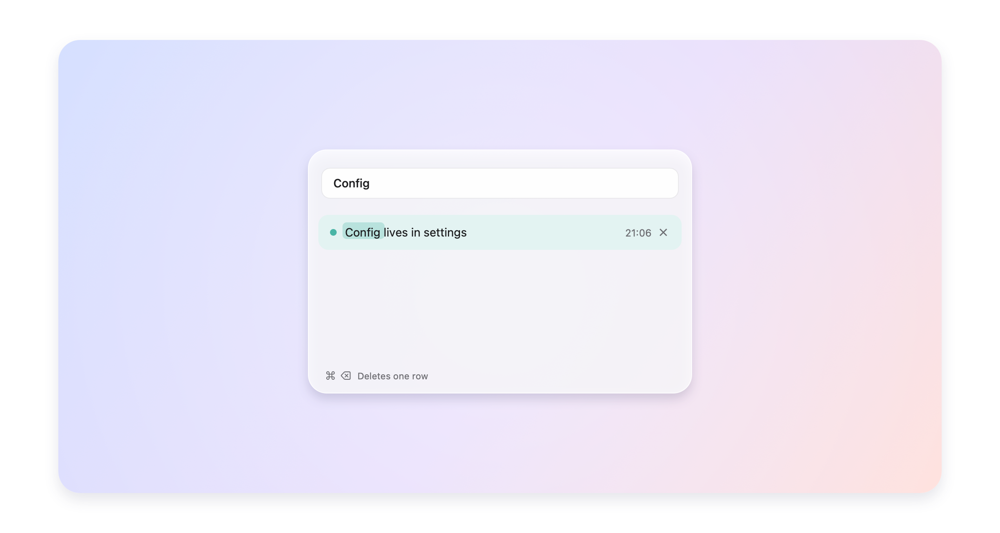
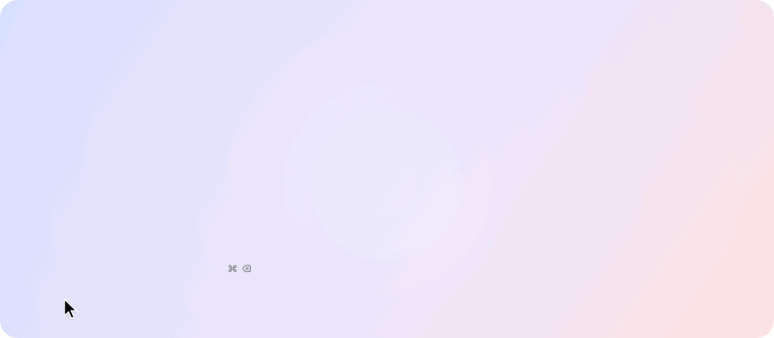
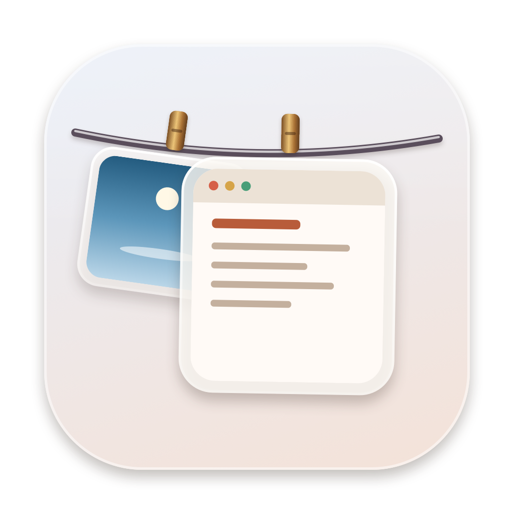

<picture>
  <source media="(prefers-color-scheme: dark)" srcset="docs/images/hero-dark.png">
  
</picture>

<p align="center">
  Free and open source. For macOS 14 and later, and Windows 11.
  <br>
  <a href="https://github.com/chen1230/Perch/releases/latest">Download&nbsp;&rsaquo;</a>
  &nbsp;&nbsp;
  <a href="#windows">Windows&nbsp;&rsaquo;</a>
  &nbsp;&nbsp;
  <a href="#build-from-source">Build from source&nbsp;&rsaquo;</a>
  <br><br>
  English&nbsp;·&nbsp;<a href="docs/i18n/README.es.md">Español</a>&nbsp;·&nbsp;<a href="docs/i18n/README.zh-Hans.md">简体中文</a>
</p>

<br>

## Out of sight. Within reach.

Every screenshot you take hangs on a line just above your screen.
Rest the pointer in the menu bar and it glides down. Move away and it's gone.

<picture>
  <source media="(prefers-color-scheme: dark)" srcset="docs/images/demo-dark.gif">
  
</picture>

<br>
<br>

## A gesture for everything.

<picture>
  <source media="(prefers-color-scheme: dark)" srcset="docs/images/bento-dark.png">
  
</picture>

<br>
<br>

| | |
|:--|:--|
| Click | Copy the image. |
| Press and hold | Open it in Markup. |
| Double click | Open it in Preview. |
| Drag into an app | Send a copy. It stays on the line. |
| Drag into a folder | Keep it there. It leaves the line. |
| Drag to the Trash, or click the cross | Let it go. |
| Rest the pointer in the menu bar | Bring the line down on that screen. |
| Click anything in the menu bar | Put it away. |
| <kbd>⌃</kbd>&thinsp;<kbd>⌥</kbd>&thinsp;<kbd>T</kbd> | Show or hide the line. Change it under Shortcut in the menu bar. |

<br>

## Your Desktop. Finally clear.

Hand Perch your screenshots<sup>1</sup> and they skip the Desktop
entirely. No floating thumbnail. No five-second wait. Each capture hangs
the instant you take it, and only what you drag out is kept.

Screen recordings hang there too, with a play button over them.
Press and hold one to trim it.

Same shortcuts. Same muscle memory. Just less mess.

<br>

## Copied images too.

Take a screenshot with <kbd>⌃</kbd> held, or copy an image in Preview, and it
hangs on the line like any other. Turn on Hang copied images in the menu bar
and the shirt fills in while it is on. Only images: anything copied along
with text or a file, and anything a password manager marks as private, is
left alone.

<br>

## Copied text.

Text you copy is kept. Screenshots stay on the line and do not join this list. There is no history panel sitting open. Press <kbd>⌃</kbd>&thinsp;<kbd>⌥</kbd>&thinsp;<kbd>V</kbd>, or choose Copied text in the menu bar, and the search window appears. Leave the box empty and it lists what you copied recently. Type, and each matched word is marked in that row's own color.

<picture>
  <source media="(prefers-color-scheme: dark)" srcset="docs/images/clipboard-dark.png">
  
</picture>

<picture>
  <source media="(prefers-color-scheme: dark)" srcset="docs/images/clipboard-demo-dark.gif">
  
</picture>

Moving the pointer away does not close it. Click outside the glass, press Esc, press the shortcut again, or pick a row, and it closes. Picking a row copies that text back and tries to paste it into the app that was in front.

The look is chosen under Theme in the menu bar. Day is the default. The others are Night, Lacquer, Spectrum, and Reflection.

Rest the pointer on a row and an × appears at the end. Click it and that one row goes, with no confirmation and no paste. <kbd>⌘</kbd>&thinsp;<kbd>⌫</kbd> deletes the selected row once. Holding it does not continue down the list. <kbd>⌫</kbd> on its own only edits the search box.

About the last 100 copies are kept on this Mac, in Perch's own folder. Files, and anything a password manager marks as private, are not recorded.

<br>

## Private by design.

No account. No network. No analytics.
Perch runs entirely on your Mac, and your screenshots never leave it.

<br>

## Tech Specs

| | |
|:--|:--|
| **Compatibility** | macOS 14 Sonoma or later, on Apple silicon and Intel. Designed for macOS 27. |
| **Size** | 1.7 MB |
| **Languages** | English, Spanish, Chinese (Simplified), Turkish, Azerbaijani |
| **Built with** | Swift, AppKit and SwiftUI |
| **Network access** | None |
| **Price** | Free |
| **License** | MIT. This copy is named Perch. See LICENSE. |

<br>

## Install

This copy is Perch. Build it from source and open `build/Perch.app`.
The upstream app is a different name and is not this one.

<br>

## Build from source

```sh
scripts/build-app.sh
open build/Perch.app
```

Requires the Swift toolchain. Xcode is optional. With the Command Line Tools for macOS 27, the script falls back to the macOS 26 SDK they install alongside, because the new SDK needs a SwiftUI macro plugin only Xcode includes. Local builds are signed ad hoc,
so macOS asks again for access to the Desktop after each rebuild.

## Windows

The Windows app is a tray program for Windows 11. Screenshots hang on a line at the top of the screen, copied text can be searched, and there are five themes. The file to send is `windows/dist/Perch-1.1.0-setup.exe`, about 79 MB. That one file is the installer.

Double-click it. Perch installs for the current user and does not ask for an administrator password. The Start menu gets one Perch shortcut. Uninstall from Settings → Apps. Copied text and screenshots stay in `%AppData%\Perch`.

| | |
|:--|:--|
| Pointer at the top edge | The line comes down. Move the pointer away and it tucks away. |
| <kbd>Ctrl</kbd>+<kbd>Alt</kbd>+<kbd>T</kbd> | Shows the line and keeps it down. Press it again and the line tucks away. |
| Win+PrtScn | A new image in Pictures\Screenshots hangs on the line. |
| Hang copied images | On the first run this is on, because Win+Shift+S only puts the picture on the clipboard. Turn it off from the tray menu. |
| Click a picture | Copies it back to the clipboard. |
| Drag along the line | The clip stays where you leave it. Drag it off the line and let go, and it returns to where it was. |
| The × on a picture | Takes it off the line. A copy Perch saved is deleted. A screenshot in your Pictures folder is not. |
| <kbd>Ctrl</kbd>+<kbd>Alt</kbd>+<kbd>V</kbd>, or Copied text | Opens search. An empty search lists recent text. Matched words are marked in that row's own color. |
| Click outside, Esc, the shortcut again, or pick a row | Closes search. Picking a row also copies the text and tries to paste it into the app that was in front. |
| Moving the pointer away | Does not close search. |
| × on a row, or <kbd>Ctrl</kbd>+<kbd>Backspace</kbd> | Deletes that one row, with no confirmation. Holding the keys does not move on to the next row. Backspace only edits the search box. |
| Themes | Night, Day, Lacquer, Spectrum, Reflection. Day is the default. |

Markup, trimming a recording, and the macOS glass look are not in this version.

Build the installer from this folder. The machine that builds it needs the .NET 8 SDK. The machine that runs the setup does not.

```sh
windows/publish.sh
windows/installer/build-setup.sh
```

| File | Role |
|:--|:--|
| `windows/Perch.Core` | Copied text, where each picture sits, theme colors |
| `windows/Perch.Windows` | The tray app |
| `windows/Perch.Setup` | The installer |
| `windows/dist/Perch-1.1.0-setup.exe` | The file to send |

<details>
<summary>Inside the app</summary>
<br>

| File | Role |
|:--|:--|
| `AppDelegate.swift` | Menu bar, shortcut, revealing and tucking away the line |
| `LinePanel.swift` | The transparent strip along the top of the screen |
| `LineView.swift` | The line and where each photo hangs |
| `PeggedView.swift` | One photo: glass frame, clip, swing and breeze |
| `GrabArea.swift` | Click, long press, drag and drop |
| `ScreenshotWatcher.swift` | Notices new screenshots |
| `ClipboardWatcher.swift` | Notices images copied to the clipboard |
| `Inbox.swift` | Takes over screenshot settings and puts them back |
| `Markup.swift` | Opens the system Markup editor and saves the result |
| `Trim.swift` | Trims a screen recording and saves the result |
| `FullScreen.swift` | Knows when to stay hidden |
| `Line.swift` | What is hanging, and what you can do with it |
| `ClipboardHistory.swift` | Saved copied text |
| `ClipboardSearch.swift` | Search window, themes on each row, deleting one row |
| `ClipboardTheme.swift` | The five looks, Daylight by default |
| `AppFiles.swift` | Where Perch keeps its files |

Every image here, the icon included, is drawn in code by
`scripts/make-icon.swift` and `scripts/make-readme-art.swift`.
`scripts/make-dmg.sh` builds the disk image for releases.

Translations live in `Sources/Perch/Resources`, one `.lproj` folder per
language. `swift scripts/check-strings.swift` checks that none is missing.

</details>

<br>

---

<sub>
1. On first launch, Perch offers to handle your screenshots. If you accept, it turns off the floating thumbnail and saves new screenshots to its own folder, two settings also found under Options in Cmd+Shift+5. Your previous settings are saved and restored when Perch quits or the option is turned off from the menu bar. Perch hides automatically while an app is in full screen.
</sub>

<br>
<br>

<p align="center">
  
  <br>
  <sub>The code is MIT licensed. This copy is Perch. See <a href="LICENSE">LICENSE</a>.</sub>
</p>
